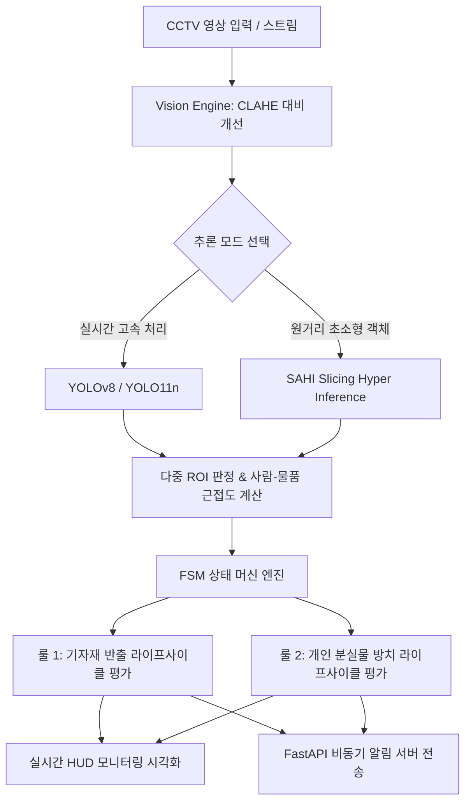
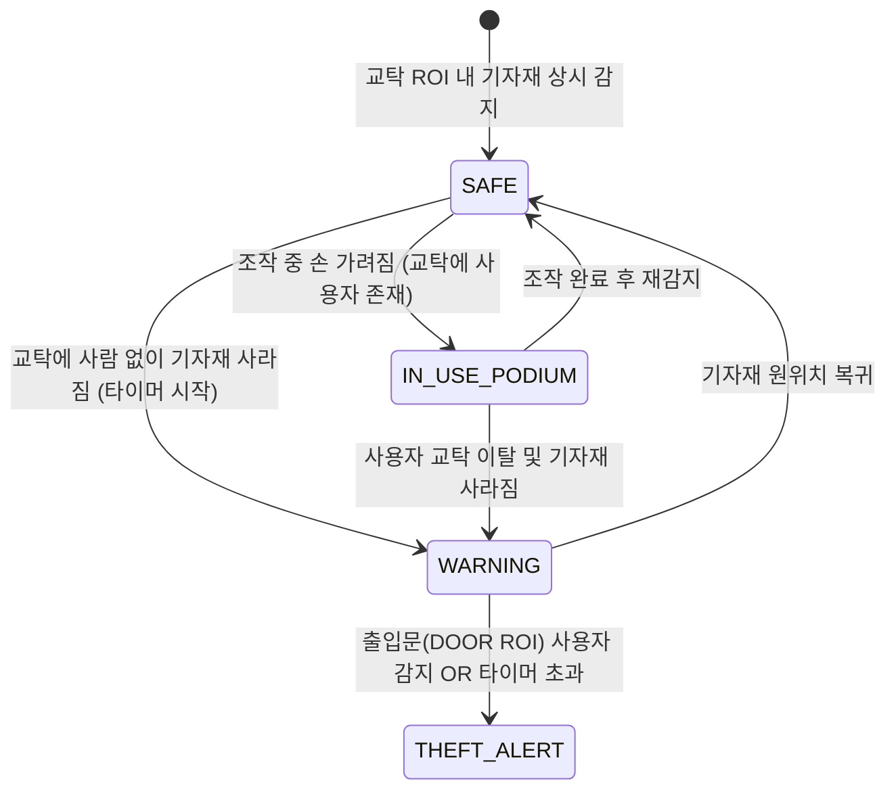
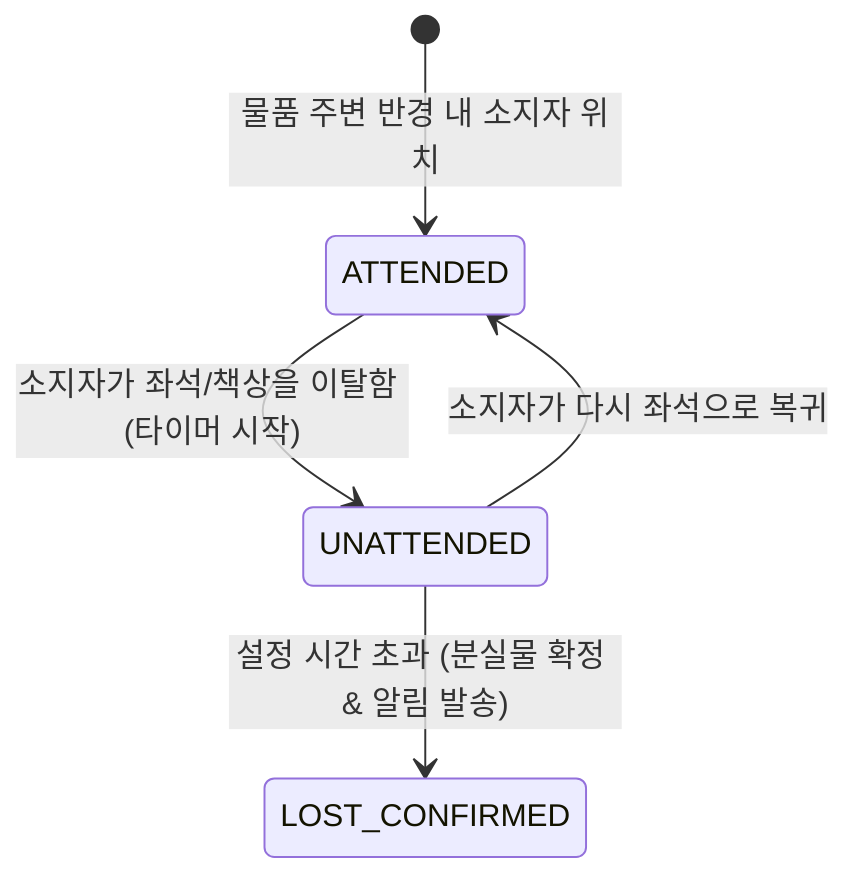

# 🏫 실습실 기자재 반출 방지 및 분실물 탐지 시스템
### Lab Asset Security & Lost Property Detection System

> **CCTV 기반 영상 인식, FSM 유한 상태 머신, SAHI 소형 객체 탐지 및 실시간 알림 파이프라인을 결합한 스마트 실습실 안전·보안 관리 솔루션**

[](https://www.python.org/)
[](https://github.com/ultralytics/ultralytics)
[](https://github.com/obss/sahi)
[](https://fastapi.tiangolo.com/)
[](LICENSE)

---

## 📋 목차
1. [프로젝트 소개](#-프로젝트-소개)
2. [핵심 아키텍처 및 원리](#-핵심-아키텍처-및-원리)
3. [주요 기능](#-주요-기능)
4. [디렉토리 구조](#-디렉토리-구조)
5. [설치 및 환경 설정](#-설치-및-환경-설정)
6. [실행 가이드](#-실행-가이드)
7. [설정 가이드 (config.py)](#-설정-가이드-configpy)
8. [라이선스](#-라이선스)

---

## 🌟 프로젝트 소개

대학 실습실, 세미나실, 전산실 등 공용 공간에서는 **공용 기자재(마우스, 키보드, HDMI 케이블, 빔프로젝터 리모컨 등)의 무단 반출/도난**과 **퇴실 시 학생들의 개인 분실물(지갑, 텀블러, 무선 이어폰 등) 방치 문제**가 빈번하게 발생합니다.

본 시스템은 고정형 CCTV 영상을 실시간으로 분석하여:
1. **공용 기자재의 위치 및 소지자 이동 경로를 추적**하여 무단 반출 시도를 조기에 감지하고 경보를 발령합니다.
2. **학생 좌석 및 책상 위 방치된 개인 물품**을 인식하고, 사용자가 퇴실한 후 일정 시간이 지나면 분실물로 자동 등록하여 분실률을 최소화합니다.



---

## ⚙️ 핵심 아키텍처 및 원리

### 1. FSM (유한 상태 머신) 기반 이벤트 라이프사이클
단순히 물체가 감지되지 않는다고 즉시 도난으로 판단하면 조작 중 손에 가려지는 현상(Occlusion)으로 인해 수많은 오경보(False Alarm)가 발생합니다. 본 시스템은 다단계 FSM을 적용하여 신뢰도 높은 상태 관리를 수행합니다.

#### 📌 룰 1: 공용 기자재 반출 방지 FSM (`AssetSecurityStateMachine`)


* **`SAFE`**: 교탁 ROI 영역에 기자재가 정상적으로 배치되어 있음
* **`IN_USE_PODIUM`**: 물품이 손에 일시적으로 가려졌으나, 교탁 영역에 사용자가 위치하여 정상 사용 중으로 판단 (오경보 차단)
* **`WARNING`**: 교탁 영역에 사람이 없는데 기자재가 사라져 이동 의심 타이머 카운트다운 진행
* **`THEFT_ALERT`**: 타이머 초과 시점 또는 **출입문(DOOR ROI) 영역에 사람이 진입할 경우 즉각 도난 경보** 발령

---

#### 📌 룰 2: 개인 분실물 방치 탐지 FSM (`LostPropertyStateMachine`)


* **`ATTENDED`**: 물품 반경(`PERSON_PROXIMITY_PIXELS`) 내에 사람이 함께 존재
* **`UNATTENDED`**: 소지자가 좌석을 비워 방치 상태로 전환되며 타이머 시작
* **`LOST_CONFIRMED`**: 지정된 시간(예: 5분, 데모 8초) 동안 복귀하지 않을 경우 분실물로 확정 등록

---

### 2. 초소형 객체 정밀 탐지 (SAHI: Slicing Aided Hyper Inference)
- CCTV 원거리 촬영 시 마우스, USB, 케이블 등 소형 기자재는 일반 YOLO 추론 시 리사이즈 과정에서 픽셀 정보 손실이 발생합니다.
- **SAHI 슬라이싱 추론 파이프라인**을 통해 고해상도 영상을 패치 단위로 분할 추론 후 NMS로 병합하여 원거리 소형 객체 검출률을 극대화했습니다.

### 3. 적응형 조명 보정 (CLAHE)
- 실습실 조명 ON/OFF, 자연 채광 및 창문 역광 상황에서도 정확한 물체 인식이 가능하도록 밝기 채널(L 채널)에 **CLAHE(Contrast Limited Adaptive Histogram Equalization)** 전처리를 선택 적용합니다.

---

## 📂 디렉토리 구조

```text
Object-Recognition-Vision/
└── computer-vision/
    └── lab_asset_lost_finder/
        ├── api/
        │   └── server.py                  # FastAPI 비동기 이벤트 알림 서버
        ├── core/
        │   ├── state_machine.py           # 기자재 & 분실물 FSM 상태 머신 엔진
        │   └── vision_engine.py           # YOLO 추론, CLAHE 전처리, 바운딩 박스 매칭
        ├── config.py                      # ROI 정규화 좌표, 타이머, 대상 클래스 설정
        ├── main.py                        # 실시간 CCTV/웹캠 분석 및 HUD 시각화 메인
        ├── sahi_yolo_video_detection.py   # SAHI 기반 고해상도 비디오 슬라이싱 탐지
        ├── sahi_yolo_detection.py         # 단일 이미지 SAHI 정밀 분석 스크립트
        ├── prepare_training_data.py       # 실습실 데이터셋 증강 및 전처리 스크립트
        ├── train_lab_model.py             # 커스텀 기자재 YOLO 파인튜닝 스크립트
        ├── evaluate_trained_model.py      # 정밀도/재현율 평가 스크립트
        ├── input_images/                  # 테스트 입력 이미지 디렉토리
        ├── input_videos/                  # 테스트 입력 비디오 디렉토리
        └── output_results/                # HUD 오버레이 분석 결과물 저장소
```

---

## 🛠️ 기술 스택

| 구분 | 주요 기술 |
| :--- | :--- |
| **객체 탐지 (Object Detection)** | `Ultralytics YOLOv8 / YOLO11`, `SAHI (Slicing Aided Hyper Inference)` |
| **영상 처리 (Computer Vision)** | `OpenCV (cv2)`, `NumPy`, `Pillow` |
| **상태 관리 (State Management)** | Python FSM (Finite State Machine Architecture) |
| **백엔드 (API & Monitoring)** | `FastAPI`, `Uvicorn`, `Pydantic` |
| **언어 및 런타임** | `Python 3.10+` |

---

## 🚀 설치 및 환경 설정

### 1. 저장소 클론 및 가상환경 설정
```bash
# 저장소 복제
git clone https://github.com/hyeonje3402/Object-Recognition-Vision.git
cd Object-Recognition-Vision

# 가상환경 생성 및 활성화
python -m venv venv
# Windows:
venv\Scripts\activate
# Linux / macOS:
source venv/bin/activate
```

### 2. 필수 라이브러리 설치
```bash
pip install ultralytics opencv-python sahi fastapi uvicorn numpy pillow
```

---

## 💻 실행 가이드

### 1. 실시간 모니터링 시스템 실행 (`main.py`)
웹캠 또는 비디오 파일을 입력받아 실시간으로 교탁, 출입문, 좌석 ROI를 추적하고 HUD를 표시합니다.
```bash
cd computer-vision/lab_asset_lost_finder

# 기본 실행 (웹캠 0번 또는 기본 비디오)
python main.py
```

### 2. SAHI 기반 초소형 객체 정밀 비디오 분석
원거리 마우스, 케이블 등 미세 객체를 고해상도 슬라이싱으로 추론합니다.
```bash
python sahi_yolo_video_detection.py
```

### 3. FastAPI 이벤트 알림 서버 구동
반출 의심 및 분실물 확정 이벤트를 수신하는 백엔드 서버를 구동합니다.
```bash
cd api
uvicorn server:app --host 0.0.0.0 --port 8000 --reload
```

---

## ⚙️ 설정 가이드 (`config.py`)

실습실 구조 및 카메라 화각에 맞추어 `config.py`에서 파라미터를 손쉽게 튜닝할 수 있습니다:

```python
# 1. 카메라 해상도 무관 (0.0 ~ 1.0 정규화 비율 좌표)
PODIUM_DESK: (0.05, 0.40, 0.40, 0.85)   # 교탁/공용 기자재 영역
DOOR_EXIT:   (0.75, 0.10, 0.98, 0.90)   # 실습실 출입문 영역
STUDENT_DESK:(0.35, 0.45, 0.85, 0.95)   # 학생 좌석/책상 영역

# 2. 타이머 및 거리 임계값
TIMER_CONFIG = {
    "ASSET_MISSING_TIMEOUT_SEC": 10.0,   # 공용 기자재 부재 허용 시간 (데모용 10초)
    "LOST_ITEM_TIMEOUT_SEC": 8.0,        # 방치 분실물 판정 시간 (데모용 8초)
    "PERSON_PROXIMITY_PIXELS": 150       # 소지자-물품 간 유효 반경 (픽셀)
}
```

---

## 📄 라이선스
This project is licensed under the MIT License - see the [LICENSE](LICENSE) file for details.
