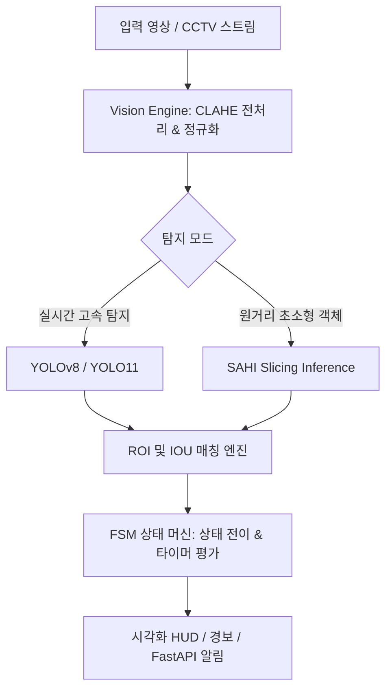

# 👁️ Object-Recognition-Vision

> **컴퓨터 비전(YOLOv8/YOLO11, SAHI) 기반 스마트 객체 감지·상태 추적 시스템 및 종합 관리 플랫폼**

[](https://www.python.org/)
[](https://github.com/ultralytics/ultralytics)
[](https://opencv.org/)
[](LICENSE)

---

## 📋 목차
1. [프로젝트 개요](#-프로젝트-개요)
2. [저장소 구조](#-저장소-구조)
3. [서브 프로젝트 상세](#-서브-프로젝트-상세)
   - [1. 실습실 기자재 반출 방지 및 분실물 탐지 시스템](#1-실습실-기자재-반출-방지-및-분실물-탐지-시스템-lab_asset_lost_finder)
   - [2. 반려견 안전 및 맹견 법령 모니터링 시스템](#2-반려견-안전-및-맹견-법령-모니터링-시스템-dog_safety_system)
   - [3. 채용 정보 관리 시스템](#3-채용-정보-관리-시스템-job-info-management-system)
   - [4. Playwright E2E 자동화 테스트 컬렉션](#4-playwright-e2e-자동화-테스트-컬렉션-playwright-test-collection)
4. [기술 스택](#-기술-스택)
5. [시작하기 (Getting Started)](#-시작하기-getting-started)
6. [라이선스](#-라이선스)

---

## 🌟 프로젝트 개요

`Object-Recognition-Vision` 저장소는 최신 딥러닝 객체 탐지(YOLOv8, YOLO11)와 영상 처리(OpenCV, SAHI) 기법을 기반으로 실생활 및 시설 관리의 안전·보안 문제를 해결하는 컴퓨터 비전 프로젝트 컬렉션입니다. 

단순 탐지를 넘어 **유한 상태 머신(Finite State Machine)**, **관심 영역(ROI) 분석**, **동적 전처리 파이프라인(CLAHE)**을 결합하여 오탐률을 최소화하고 실시간 이벤트 트리거링을 제공합니다.



---

## 📂 저장소 구조

```text
Object-Recognition-Vision/
├── computer-vision/
│   ├── lab_asset_lost_finder/       # 🏫 실습실 기자재 반출 방지 & 분실물 탐지
│   │   ├── api/                     # FastAPI 웹 백엔드 및 알림 엔드포인트
│   │   ├── core/                    # FSM 상태 머신 및 비전 엔진 코어
│   │   │   ├── state_machine.py     # 기자재/분실물 라이프사이클 FSM
│   │   │   └── vision_engine.py     # YOLO + CLAHE 영상 추론 엔진
│   │   ├── config.py                # ROI 좌표, 타이머, 임계값 설정
│   │   ├── main.py                  # 실시간 영상 처리 및 HUD 렌더러
│   │   ├── sahi_yolo_detection.py   # SAHI 소형 물체 고해상도 슬라이싱 탐지
│   │   └── prepare_training_data.py # 파인튜닝 데이터셋 전처리 파이프라인
│   │
│   ├── dog_safety_system/           # 🐕 동물보호법 기반 반려견/맹견 안전 모니터링
│   │   ├── detect_dog_safety.py     # 이미지 기반 목줄·입마개·맹견 위험도 평가
│   │   ├── detect_cctv_video.py     # CCTV 영상 실시간 안전 규정 준수 추적
│   │   └── input_images/            # 테스트 샘플 이미지
│   │
│   └── models/ (*.pt)               # 사전 학습된 YOLO 가중치 모델
│
├── job-info-management-system/      # 💼 채용 및 취업 정보 관리 프론트엔드 (React + Vite)
├── playwright-test-collection/      # 🧪 웹 애플리케이션 E2E 종합 테스트 수트
└── README.md
```

---

## 🔍 서브 프로젝트 상세

### 1. 실습실 기자재 반출 방지 및 분실물 탐지 시스템 (`lab_asset_lost_finder`)
* **목적**: 대학/학원 실습실 내 공용 기자재(마우스, 케이블 등)의 무단 반출 방지 및 퇴실 후 방치된 개인 분실물(지갑, 텀블러, 노트북 등) 자동 식별
* **핵심 기능**:
  - **다중 구역 ROI 분석**: 교탁 구역(PODIUM), 퇴실 문(DOOR EXIT), 학생 책상 구역 분리 모니터링
  - **FSM 상태 머신(Finite State Machine)**:
    - *기자재(Asset)*: `STABLE` ➡️ `IN_USE` ➡️ `MISSING` ➡️ `SUSPECTED_THEFT` (퇴실문 통과 시 경보)
    - *분실물(Lost Property)*: `ACCOMPANIED` ➡️ `UNATTENDED` (일정 시간 방치) ➡️ `LOST_CONFIRMED`
  - **SAHI (Slicing Aided Hyper Inference)**: 4K/FHD 고해상도 CCTV에서 멀리 떨어진 소형 USB, 마우스, 케이블 정밀 인식
  - **적응형 영상 전처리 (CLAHE)**: 조명 변화가 심한 실습실 환경에서 국소 대비 개선

### 2. 반려견 안전 및 맹견 법령 모니터링 시스템 (`dog_safety_system`)
* **목적**: 대한민국 동물보호법(제13조의2)에 명시된 맹견 관리 규정 준수 모니터링 및 공공 안전 확보
* **핵심 기능**:
  - **견종 및 위험도 분석**: 도사견, 핏불테리어, 로트와일러 등 5대 맹견 품종 및 일반 반려견 구분
  - **안전 장구 감지**: 목줄(Leash) 착용 거리 및 입마개(Muzzle) 착용 여부 분석
  - **위험 알림**: 보호자 미동반 단독 보행, 어린이 보호구역 출입 시 과태료 안내 및 즉각 경보 송출

### 3. 채용 정보 관리 시스템 (`job-info-management-system`)
* **목적**: 구직 공고, 지원 일정, 상태(서류/면접/합격)를 체계적으로 추적·관리하는 대시보드
* **기술**: React 18, Vite, CSS Modules, LocalStorage/REST API 연동

### 4. Playwright E2E 자동화 테스트 컬렉션 (`playwright-test-collection`)
* **목적**: 웹 서비스 안정성 보장을 위한 종합 자동화 테스트 아키텍처
* **테스트 수트**: 기본 Form 검증, 드래그&드롭, iframe/팝업 제어, 네트워크 모킹, 비주얼 회귀 테스트, 디바이스 에뮬레이션

---

## 🛠️ 기술 스택

| 분류 | 기술 및 라이브러리 |
| :--- | :--- |
| **Vision & Deep Learning** | `Python 3.10+`, `Ultralytics YOLOv8 / YOLO11`, `SAHI`, `PyTorch` |
| **Image & Video Processing** | `OpenCV (cv2)`, `NumPy`, `Pillow` |
| **Backend & API** | `FastAPI`, `Uvicorn`, `Pydantic` |
| **Frontend & Web** | `React`, `Vite`, `JavaScript (ES6+)`, `Tailwind CSS` |
| **Testing & Automation** | `Playwright`, `ESLint` |

---

## 🚀 시작하기 (Getting Started)

### 1. 저장소 클론 및 가상환경 설정
```bash
# 저장소 복제
git clone https://github.com/hyeonje3402/Object-Recognition-Vision.git
cd Object-Recognition-Vision

# 가상환경 생성 및 활성화
python -m venv venv
# Windows:
venv\Scripts\activate
# Linux/macOS:
source venv/bin/activate
```

### 2. 컴퓨터 비전 의존성 패키지 설치
```bash
pip install ultralytics opencv-python sahi fastapi uvicorn numpy pillow
```

### 3. 프로젝트 실행 예시

#### [실습실 분실물/기자재 감지 시스템 실행]
```bash
cd computer-vision/lab_asset_lost_finder

# 실시간 웹캠 또는 비디오 분석 실행
python main.py

# SAHI 기반 소형 객체 고정밀 탐지 실행
python sahi_yolo_video_detection.py
```

#### [반려견 안전 감지 시스템 실행]
```bash
cd computer-vision/dog_safety_system

# 테스트 이미지 분석 실행
python detect_dog_safety.py

# CCTV 영상 모니터링 실행
python detect_cctv_video.py
```

#### [채용 정보 관리 시스템 실행]
```bash
cd job-info-management-system
npm install
npm run dev
```

---

## 📄 라이선스
This project is licensed under the MIT License - see the [LICENSE](LICENSE) file for details.
