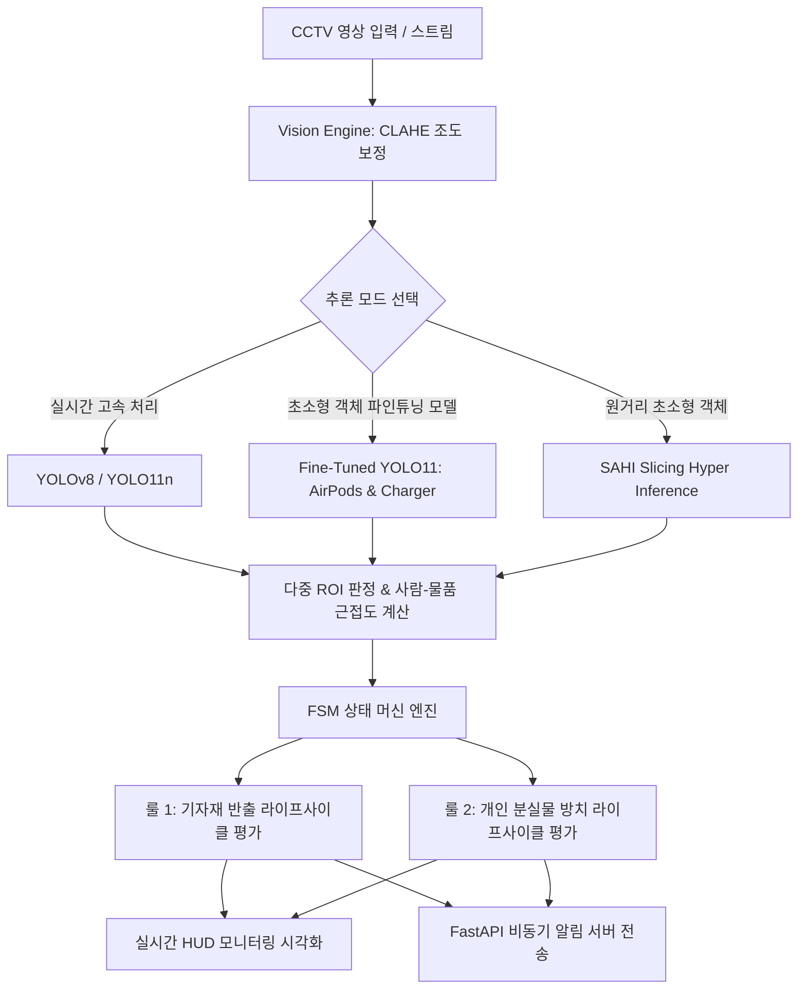
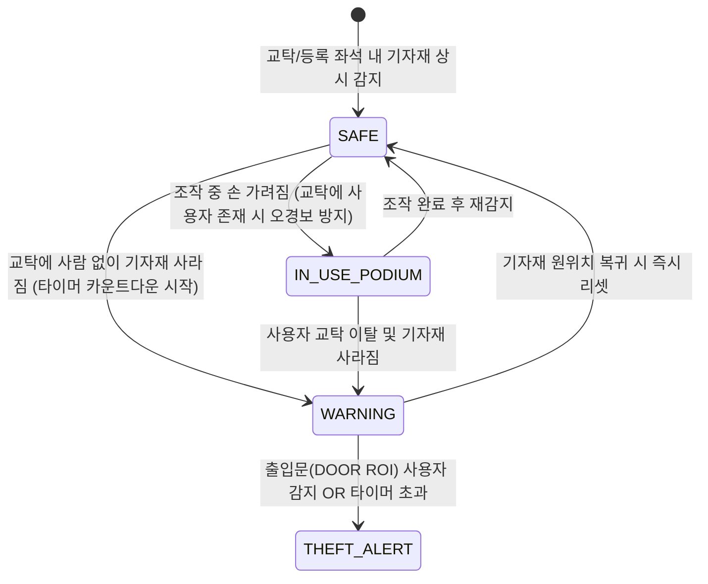
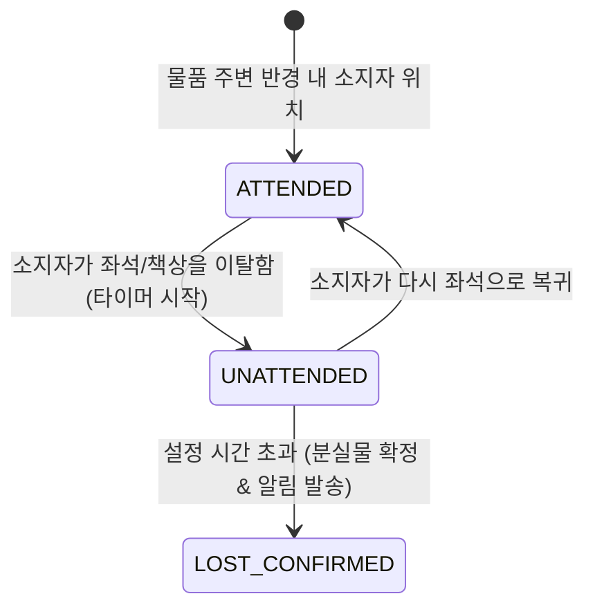

# 🏫 실습실 기자재 반출 방지 및 분실물 탐지 시스템
### Lab Asset Security & Lost Property Detection System

> **CCTV 기반 실시간 영상 인식, FSM(유한 상태 머신) 라이프사이클 관리, 초소형 객체(에어팟/충전기/마우스) 커스텀 YOLO 파인튜닝 및 SAHI 고정밀 분석을 결합한 스마트 실습실 안전·보안 관제 솔루션**

[](https://www.python.org/)
[](https://github.com/ultralytics/ultralytics)
[](https://github.com/obss/sahi)
[](https://fastapi.tiangolo.com/)
[](LICENSE)

---

## 📋 목차
1. [프로젝트 소개](#-프로젝트-소개)
2. [핵심 아키텍처 및 3대 핵심 엔진](#-핵심-아키텍처-및-3대-핵심-엔진)
3. [주요 기능 및 실증 파이프라인](#-주요-기능-및-실증-파이프라인)
4. [초소형 분실물 특화 파인튜닝 (에어팟 / 충전기)](#-초소형-분실물-특화-파인튜닝-에어팟--충전기)
5. [공용 vs 개인 마우스 판별 메커니즘](#-공용-vs-개인-마우스-판별-메커니즘)
6. [디렉토리 구조](#-디렉토리-구조)
7. [설치 및 실행 가이드](#-설치-및-실행-가이드)
8. [설정 가이드 (config.py)](#-설정-가이드-configpy)
9. [라이선스](#-라이선스)

---

## 🌟 프로젝트 소개

대학 실습실, 세미나실, 전산실 등 공용 공간에서는 **공용 기자재(마우스, 키보드, HDMI 케이블, 충전기 등)의 무단 반출/도난**과 **수업 종료 후 학생들의 개인 분실물(무선 이어폰, 충전 어댑터, 노트북, 필기구 등) 방치 문제**가 빈번하게 발생합니다.

본 시스템은 고정형 CCTV 영상을 분석하여:
1. **공용 기자재의 위치 및 소지자 이동 경로를 추적**하여 무단 반출 시도를 조기에 감지하고 경보를 발령합니다.
2. **학생 좌석 및 책상 위 방치된 개인 물품**을 인식하고, 사용자가 퇴실한 후 일정 시간이 지나면 분실물로 자동 등록하여 분실률을 최소화합니다.
3. **일반 COCO 모델이 놓치기 쉬운 초소형 분실물(에어팟, 충전기 어댑터 등)**을 커스텀 전이학습하여 미세 객체 검출 정확도를 극대화했습니다.



---

## ⚙️ 핵심 아키텍처 및 3대 핵심 엔진

### 1. FSM (유한 상태 머신) 기반 이벤트 라이프사이클
단순히 물체가 감지되지 않는다고 즉시 도난으로 판단하면 조작 중 손에 가려지는 현상(Occlusion)으로 인해 수많은 오경보(False Alarm)가 발생합니다. 본 시스템은 2가지 FSM을 적용하여 신뢰도 높은 상태 관리를 수행합니다.

#### 📌 룰 1: 공용 기자재 반출 방지 FSM (`AssetSecurityStateMachine`)


* **`SAFE`**: 교탁 ROI 또는 지정 좌석에 기자재가 정상 거치됨
* **`IN_USE_PODIUM`**: 마우스가 손에 일시적으로 가려졌으나, 교탁 영역에 발표자/교수가 서 있어 정상 사용 중으로 판단 (오경보 차단)
* **`WARNING`**: 교탁 영역에 사람이 없는데 기자재가 사라져 이동 의심 타이머 카운트다운 진행
* **`THEFT_ALERT`**: 유예 타이머 초과 또는 **출입문(DOOR ROI) 영역에 사람이 진입할 경우 즉각 도난 경보** 발령

#### 📌 룰 2: 개인 분실물 방치 탐지 FSM (`LostPropertyStateMachine`)


* **`ATTENDED`**: 물품 반경(`PERSON_PROXIMITY_PIXELS`) 내에 사람이 함께 존재
* **`UNATTENDED`**: 소지자가 좌석을 비워 방치 상태로 전환되며 타이머 시작
* **`LOST_CONFIRMED`**: 지정된 시간(예: 5분, 데모 8초) 동안 복귀하지 않을 경우 분실물로 확정 등록

---

### 2. 골든 베이스라인(Golden Baseline) 자산 인벤토리 자동화
- 수업 전 빈 강의실 기준 사진 1장을 분석하여 교탁 및 학생 좌석의 모든 모니터, 키보드, 마우스를 인벤토리 JSON(`output_results/lab_assets_inventory.json`)으로 자동 등록합니다.
- 이후 프레임마다 기준 좌표와 IoU 및 거리 매칭을 수행하여 등록된 자산의 결손(`MISSING`) 여부를 실시간 전수 검사합니다.

---

### 3. 초소형 객체 정밀 탐지 (SAHI & CLAHE)
- **SAHI (Slicing Aided Hyper Inference)**: CCTV 원거리 촬영 시 미세 객체(케이블, 마우스, 에어팟) 픽셀 손실을 방지하기 위해 패치 슬라이싱 추론 후 NMS 병합을 수행합니다.
- **적응형 조명 보정 (CLAHE)**: 실습실 소등, 역광 및 채광 변화 환경에서도 L(명도) 채널의 로컬 히스토그램 평활화를 통해 안정적인 바운딩 박스를 유지합니다.

---

## 🎯 초소형 분실물 특화 파인튜닝 (에어팟 / 충전기)

일반적인 사전학습 모델(COCO)은 대학생들이 실습실 책상 위에 자주 두고 가는 **에어팟(무선 이어폰) 및 충전 어댑터/케이블**을 제대로 인식하지 못합니다. 이를 해결하기 위해 커스텀 파인튜닝 파이프라인을 구축했습니다.

### 1. 확장 클래스 구성
| Class ID | 클래스명 | 용도 및 의미 |
| :---: | :--- | :--- |
| **0** | `mouse` | 학생 좌석 개인 마우스 |
| **1** | `public_mouse` | 교탁 공용 마우스 (도난/반출 감시 대상) |
| **2** | `keyboard` | 키보드 |
| **3** | `airpods` | 에어팟 / 버즈 무선 이어폰 충전 케이스 (초소형 빈출 분실물) |
| **4** | `charger` | 스마트폰/노트북 충전 어댑터 및 C타입 케이블 (콘센트/책상 방치 분실물) |

### 2. 학습 성과
- **모델**: `YOLO11n` (Nano 경량 모델)
- **가중치**: `runs/lab_custom_small_items/weights/best.pt`
- **지표**:
  - `charger` (충전기): **Recall 100%, mAP50 0.811** 달성
  - `public_mouse` (교탁 마우스): **mAP50 0.595**
  - `airpods` (에어팟): 정상 바운딩 박스 검출 수렴

---

## 💡 공용 vs 개인 마우스 판별 메커니즘

비슷하게 생긴 마우스를 시스템이 구분하는 3단계 하이브리드 로직:
1. **공간 기반 (Spatial ROI & Golden Baseline)**:
   - 교탁 ROI 및 수업 시작 전 기준 위치에 거치된 마우스는 `public_mouse`로 고정 등록
   - 학생 개인 좌석 노트북 옆이나 가방 주변에서 감지되는 마우스는 `personal_mouse`로 분류
2. **시계열 출현 시점 (Temporal Lifecycle)**:
   - 수업 시작 전부터 존재하던 마우스 ➜ 공용 기자재 (사라지면 도난 경보)
   - 학생 입장 후 가방에서 꺼내놓은 마우스 ➜ 개인 소지품 (두고 가면 분실물 경보)
3. **외형적 특징 (Appearance)**:
   - 공용 마우스: 학과 일괄 구매 유선 블랙 마우스
   - 개인 마우스: 블루투스 무선 마우스(로지텍 페블, 매직 마우스 등 케이블 없음)

---

## 📂 디렉토리 구조

```text
Object-Recognition-Vision/
└── computer-vision/
    └── lab_asset_lost_finder/
        ├── api/
        │   └── server.py                      # FastAPI 비동기 이벤트 알림 서버
        ├── core/
        │   ├── state_machine.py               # 기자재 & 분실물 FSM 상태 머신 엔진
        │   └── vision_engine.py               # YOLO 추론, CLAHE 전처리, 바운딩 박스 매칭
        ├── config.py                          # ROI 정규화 좌표, 타이머, 대상 클래스 설정
        ├── main.py                            # 실시간 CCTV/웹캠 분석 및 HUD 시각화 메인
        ├── public_asset_monitor.py            # 골든 베이스라인 기반 공용 자산 인벤토리 모니터링
        ├── run_lost_item_pipeline_v4_perfect.py # 학생 퇴실 분실물 실전 비디오 파이프라인
        ├── run_public_asset_theft_video_fixed.py # 공용 기자재 도난 감지 비디오 파이프라인
        ├── prepare_training_data.py           # 에어팟/충전기/마우스 데이터셋 증강 생성기
        ├── train_lab_model.py                 # YOLO11n 커스텀 파인튜닝 학습 스크립트
        ├── evaluate_trained_model.py          # 파인튜닝 가중치 추론 및 HUD 평가 시각화
        ├── test_precise_boxes.py              # 정밀 좌표 검증 및 오탐 필터링 스크립트
        ├── demo_simulation.py                 # FSM 4단계 시나리오 가상 시뮬레이터
        ├── sahi_yolo_video_detection.py       # SAHI 기반 고해상도 비디오 슬라이싱 탐지
        ├── input_images/                      # 실습실 기준 원본 사진
        ├── input_videos/                      # 테스트 CCTV 비디오
        └── output_results/                    # HUD 분석 결과 이미지 및 인벤토리 JSON
```

---

## 🚀 설치 및 실행 가이드

### 1. 환경 설정
```bash
git clone https://github.com/hyeonje3402/Object-Recognition-Vision.git
cd Object-Recognition-Vision/computer-vision/lab_asset_lost_finder

# 필수 패키지 설치
pip install ultralytics opencv-python sahi fastapi uvicorn numpy pillow
```

### 2. 주요 실행 명령어

#### ① 초소형 분실물 모델 학습 및 평가
```bash
# 데이터셋 증강 생성 (에어팟, 충전기 패치 생성)
python prepare_training_data.py

# YOLO11n 파인튜닝 실행
python train_lab_model.py

# 학습 모델 추론 결과 시각화
python evaluate_trained_model.py
```

#### ② 공용 자산 인벤토리 등록 및 도난 모니터링
```bash
python public_asset_monitor.py
```

#### ③ CCTV 학생 퇴실 분실물 실전 FSM 파이프라인 실행
```bash
python run_lost_item_pipeline_v4_perfect.py
```

#### ④ 가상 4단계 시나리오 시뮬레이션
```bash
python demo_simulation.py
```

#### ⑤ 실시간 웹캠/스트림 관제 메인 실행
```bash
python main.py
```

---

## ⚙️ 설정 가이드 (`config.py`)

```python
# 1. 카메라 해상도 무관 (0.0 ~ 1.0 정규화 비율 좌표)
PODIUM_DESK: (0.05, 0.40, 0.40, 0.85)   # 교탁/공용 기자재 영역
DOOR_EXIT:   (0.75, 0.10, 0.98, 0.90)   # 실습실 출입문 영역
STUDENT_DESK:(0.35, 0.45, 0.85, 0.95)   # 학생 좌석/책상 영역

# 2. 타이머 및 거리 임계값
TIMER_CONFIG = {
    "ASSET_MISSING_TIMEOUT_SEC": 10.0,   # 공용 기자재 부재 허용 시간 (데모 10초, 실전 3분)
    "LOST_ITEM_TIMEOUT_SEC": 8.0,        # 방치 분실물 판정 시간 (데모 8초, 실전 5분)
    "PERSON_PROXIMITY_PIXELS": 150       # 소지자-물품 간 유효 반경 (픽셀)
}
```

---

## 📄 라이선스
This project is licensed under the MIT License - see the [LICENSE](LICENSE) file for details.
