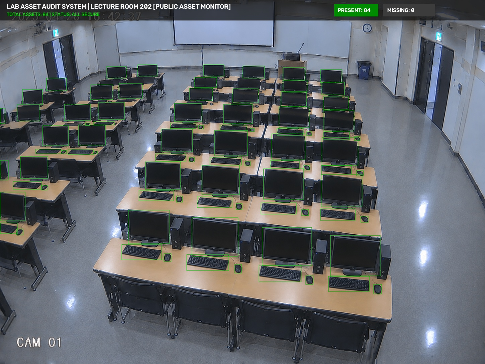
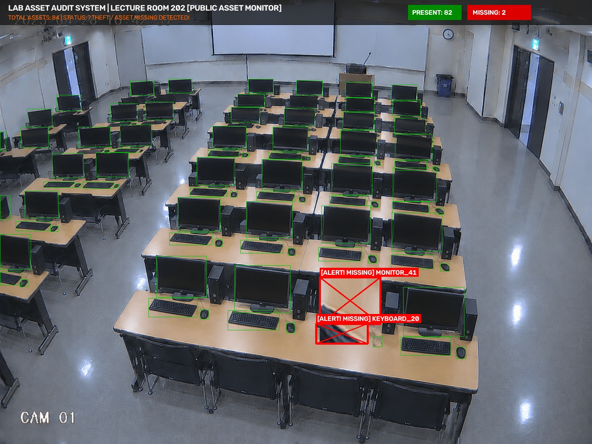

# 실습실 기자재·분실물 탐지 시스템

CCTV 또는 녹화 영상을 분석해 실습실 공용 기자재의 반출 의심 상황과 자리를 비운 뒤 남은 개인 물품을 탐지하는 컴퓨터 비전 프로젝트입니다.

## 프로젝트 개요

| 항목 | 내용 |
|---|---|
| 목적 | 실습실 기자재 상태와 방치 물품을 영상에서 찾아 담당자가 확인할 수 있도록 지원 |
| 주요 기능 | 사람·물품 검출, 관심 구역(ROI) 분석, 상태 추적, 경보 HUD와 사건 보고서 생성 |
| 모델·비전 | Python, OpenCV, Ultralytics YOLOv8/YOLO11, PyTorch, SAHI, CLAHE |
| 추적·판정 | ByteTrack 기반 추적 구성, 사용자 정의 FSM, ROI·거리 규칙 |
| API 실험 | FastAPI REST 상태 조회 및 WebSocket 경보 서버 예제 |
| 데이터 저장 | 분석 파일과 결과물을 로컬 경로에 저장. 운영용 DB는 구성되어 있지 않음 |

## 전체 흐름

~~~mermaid
flowchart LR
    A[CCTV 웹캠 또는 녹화 영상] --> B[OpenCV 전처리·CLAHE]
    B --> C[YOLO 객체 검출 / 소형 객체 보강]
    C --> D[사람·물품 추적 및 ROI 판정]
    D --> E[FSM 상태 전이]
    E --> F[HUD·사건 보고서 JPG/HTML/JSON]
    E --> G[FastAPI/WebSocket 연동 실험]
~~~

현재 탐지 파이프라인은 로컬 영상 처리 중심입니다. API 서버는 별도 연동을 위한 기본 구현이며, 실제 현장 CCTV 서비스나 상용 경보 시스템이 배포된 상태를 뜻하지 않습니다.

## 상세 문서

- [아키텍처·판정 흐름](docs/architecture/README.md)
- [설치·실행·설정](docs/development/README.md)
- [실험 결과와 다음 개선안](docs/roadmap/README.md)
- [실습실 탐지 구현 노트](computer-vision/lab_asset_lost_finder/README.md)
- [주차별 실습 보고서](computer-vision/lab_asset_lost_finder/docs/reports/)

## 빠른 시작

프로젝트 루트에서 아래 경로로 이동해 의존성을 설치하고 카메라 또는 영상 입력 파이프라인을 실행합니다.

~~~bash
cd computer-vision/lab_asset_lost_finder
pip install ultralytics opencv-python sahi fastapi uvicorn numpy pillow
python main.py
~~~

모델 가중치, 입력 영상, ROI와 타이머 설정은 [개발 문서](docs/development/README.md)를 먼저 확인하세요. 탐지 정확도와 도난 판정 결과는 카메라 배치와 입력 영상에 따라 달라집니다.

## 현재 검증 상태

2026-11-26 저장소 점검에서는 원격 README와 브랜치만 확인했습니다. 전체 로컬 clone이 없어 이번 점검에서 의존성 설치, 영상 추론, API 실행 또는 자동화 테스트를 수행하지 않았습니다. 따라서 이 README의 기능 설명은 구현 설명이며 현장 정확도나 운영 배포 검증을 뜻하지 않습니다.

## 실제 추론 결과 화면

아래 자료는 저장소에 포함된 CCTV 실습 영상에서 실행한 YOLO 기반 객체 추론 결과입니다. 입력 장면은 실습용 합성/샘플 영상이며 실제 시설의 운영 CCTV 결과가 아닙니다.

| 화면 | 자료 |
|---|---|
| 기자재 전체 재고 기준선 |  |
| 기자재 누락 경보 |  |
